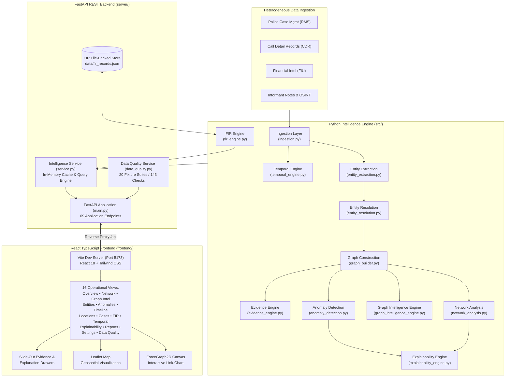

# Crime Network Intelligence System (CNIS)
### Advanced Link Analysis, Graph Analytics & Decision-Support Platform for Criminal Investigations

[](LICENSE)
[](https://www.python.org/)
[](https://fastapi.tiangolo.com/)
[](https://react.dev/)
[](https://www.typescriptlang.org/)
[](https://vitejs.dev/)
[](https://tailwindcss.com/)

---

## 1. Professional Introduction

The **Crime Network Intelligence System (CNIS)** is an investigative intelligence platform designed to assist law enforcement analysts and investigators in synthesizing unstructured, multi-source criminal case information into structured, actionable intelligence graphs.

Modern criminal investigations often span multiple disconnected documentation streams: police First Information Reports (FIR), surveillance logs, call detail records (CDR), suspicious transaction reports, vehicle automated number plate recognition (ANPR) sightings, and informant field notes. CNIS normalizes these heterogeneous inputs, extracts and resolves entities across records, constructs a multi-relational co-occurrence graph, computes network centrality and community structures, detects behavioral anomalies, and presents the results in an investigator-facing web dashboard.

> [!NOTE]
> **Epistemic Notice & Decision-Support Principle**:
> CNIS is designed strictly as an investigative decision-support tool. In accordance with established legal jurisprudence, graph centrality, community clusters, and anomaly signals reflect mathematical correlation within recorded intelligence feeds. They **do not constitute judicial proof of guilt, criminal conspiracy, or syndicate leadership**. Automated outputs are flagged for human investigator review.

---

## 2. Project Purpose, Problem Statement & Objectives

### The Problem
- **Data Fragmentation**: Critical connections between suspects, burner phones, shell companies, and safehouse locations are buried across disparate narrative reports.
- **Cognitive Overload**: Human analysts cannot manually trace multi-hop relationship chains or evaluate network-level metrics (such as bridge nodes or betweenness bottlenecks) across dozens of overlapping case files.
- **Entity Ambiguity**: The same individual or asset is frequently referenced across agencies using spelling variations, nicknames, aliases, or unformatted contact numbers.
- **Lack of Explainability**: Many algorithmic systems act as "black boxes," flagging individuals without providing verifiable evidentiary traces or step-by-step mathematical justifications required for legal scrutiny.

### Objectives
1. **Automated Ingestion**: Normalize multi-source records (RMS case reports, CDR logs, FIU alerts, informant tips) into a unified schema.
2. **Deterministic Entity Extraction & Resolution**: Extract persons, organizations, locations, vehicles, phone numbers, and monetary amounts; resolve cross-record variants into canonical entity profiles with confidence scoring and human review queues.
3. **Graph-Theoretic Analysis**: Model co-occurrence relationships and compute degree, betweenness, eigenvector centrality, PageRank, and Louvain community structures.
4. **Behavioral Anomaly Detection**: Identify operational burst coordination, transaction structuring, sudden cluster-entry spikes, and multivariate statistical outliers using Isolation Forests.
5. **Full Provenance & Explainability**: Ground every network link, score, and anomaly in verbatim source excerpts with traceable evidence IDs.
6. **Statutory FIR Intake Workspace**: Provide a First Information Report (FIR) management module aligned with the **Bharatiya Nyaya Sanhita (BNS, 2023)** and legacy Indian Penal Code (IPC) cross-mappings.

---

## 3. Implemented Features & Key Capabilities

- **Interactive Network Graph Visualization**:
  - WebGL-accelerated 2D force-directed link chart powered by `react-force-graph-2d`.
  - Type-based color coding (Person, Phone, Vehicle, Location, Org, Money).
  - Node focus mode, neighborhood isolation (1-hop & 2-hop subgraphs), and real-time entity filtering.
- **Advanced Graph Intelligence**:
  - Articulation point and bridge-node detection to identify structural bottlenecks and potential disruption targets.
  - Louvain community detection to surface sub-cells or operational clusters.
  - Multi-metric centrality comparison matrix with side-by-side entity comparisons.
  - Topological motif detection (triangles, star-hubs, boundary bridges).
- **Deterministic Entity Resolution**:
  - Normalization pipelines for phone numbers (E.164 / 10-digit), vehicle plates, monetary amounts, and corporate suffixes.
  - Multi-signal candidate matching incorporating exact string match, token Jaccard similarity, and shared phone/vehicle alignment.
  - Dedicated review queue flagging ambiguous matches for human-in-the-loop analyst adjudication.
- **Behavioral Anomaly Engine**:
  - Rule-based detectors for temporal burst coordination and cash structuring evasion.
  - Unsupervised machine learning via `scikit-learn` Isolation Forest trained on graph structural features (`random_state=42` for determinism).
- **Evidence Provenance & Explainability**:
  - Inverted evidence index linking every graph assertion back to source records with byte-level excerpt grounding.
  - Step-by-step mathematical derivations explaining centrality ranking, community assignment, and anomaly triggers.
- **Temporal Intelligence Engine**:
  - Longitudinal timeline analysis with daily, weekly, and monthly activity density binning.
  - Network evolution snapshots tracking when entities and relationships first appeared or went inactive.
  - Gap analysis identifying periods of silence without assuming operational cessation.
- **FIR Management Workspace**:
  - Structured intake management supporting complainant, accused, incident, and property records.
  - Built-in reference catalogue of canonical Bharatiya Nyaya Sanhita (BNS, 2023) provisions with IPC legacy cross-mappings.
  - Automated BNS legal provision suggestion based on incident category and narrative text.
- **Adversarial Robustness & Data Quality Suite**:
  - Built-in test harness executing 143 test evaluations across 20 synthetic adversarial fixture categories (handling near-duplicates, Unicode variations, malformed data, and isolated components).

---

## 4. Technology Stack & Architecture

### Backend & Analytics Engine
- **Language**: Python 3.10+ (tested on Python 3.14)
- **API Framework**: FastAPI 0.110+
- **ASGI Server**: Uvicorn 0.28+
- **Graph Modeling & Analysis**: NetworkX 3.4+
- **Numerical & Data Processing**: Pandas 2.0+, NumPy 2.0+, SciPy 1.18+
- **Machine Learning**: Scikit-Learn 1.3+ (Isolation Forest outlier detection)
- **Visualization Export**: Matplotlib 3.8+ (static charts), PyVis / custom D3 HTML

### Frontend Application
- **UI Library**: React 18.3
- **Language**: TypeScript 5.7
- **Bundler / Dev Server**: Vite 6.0
- **Routing**: React Router DOM 7.1
- **Styling**: Tailwind CSS 3.4, PostCSS, Autoprefixer
- **Network Graph Rendering**: React Force Graph 2D (`react-force-graph-2d` 1.26+)
- **Geospatial Mapping**: Leaflet 1.9+, React Leaflet
- **Icons**: Lucide React 0.469+
- **HTTP Client**: Axios 1.7+

---

## 5. System Architecture Diagram



---

## 6. Project Folder Structure

```
Crime-Network-Intelligence-System/
├── .env.example                 # Environment configuration template
├── .gitignore                   # Excluded files (virtualenvs, node_modules, caches)
├── README.md                    # System documentation and operational guide
├── README.pdf                   # Static architectural specification document
├── requirements.txt             # Python runtime and analytical dependencies
├── start_local.ps1              # Single-command PowerShell launch script
│
├── data/                        # Intelligence datasets and testing fixtures
│   ├── fir_records.json         # File-backed FIR intake registry
│   ├── sample_records.json      # Primary synthetic demonstration dataset
│   └── test_fixtures/           # 20 adversarial robustness test fixture suites
│       ├── anomaly_robustness/  # Small dataset and search robustness tests
│       ├── conflicts/           # Conflicting entity observation fixtures
│       ├── duplicates/          # Exact and near-duplicate record fixtures
│       ├── entity_variations/   # Name ambiguity, phone, and plate variations
│       ├── graph_integrity/     # Self-loops, disconnected components, false edges
│       ├── malformed_records/   # Corrupted and special-character JSON fixtures
│       ├── missing_data/        # Null and missing attribute fixtures
│       └── temporal_edges/      # Burst edge cases and temporal anomaly fixtures
│
├── frontend/                    # React 18 + TypeScript + Vite web client
│   ├── index.html               # Frontend HTML5 entry template
│   ├── package.json             # NPM dependencies and build scripts
│   ├── package-lock.json        # Deterministic dependency lockfile
│   ├── postcss.config.js        # PostCSS configuration
│   ├── tailwind.config.js       # Tailwind CSS theme and utility definitions
│   ├── tsconfig.json            # TypeScript compiler configuration
│   ├── vite.config.ts           # Vite bundler configuration & /api reverse proxy
│   ├── dist/                    # Production compiled build artifacts
│   ├── public/                  # Static assets (shield.svg favicon)
│   └── src/
│       ├── main.tsx             # React DOM root mounting
│       ├── App.tsx              # Main routing and navigation shell
│       ├── index.css            # Global CSS styles & glassmorphism variables
│       ├── api/                 # Axios HTTP client & API route bindings
│       │   └── client.ts        # Typed client methods for all 69 backend endpoints
│       ├── components/          # Modular UI components
│       │   ├── auth/            # Protected routes & system boot sequence
│       │   ├── common/          # Global search modal (Ctrl+K)
│       │   ├── investigation/   # Live view modal
│       │   ├── layout/          # Top navigation Header and Sidebar
│       │   ├── EvidenceDrawer.tsx           # Slide-out provenance drawer
│       │   ├── ExplanationDrawer.tsx        # Mathematical explanation drawer
│       │   ├── GraphIntelligenceDrawer.tsx  # Graph intelligence inspection drawer
│       │   └── TemporalDrawer.tsx           # Temporal trajectory drawer
│       ├── context/             # Global React state providers
│       │   ├── AuthContext.tsx  # Demo authentication and session store
│       │   └── ThemeContext.tsx # Dark / light mode theme management
│       ├── pages/               # 16 operational page components
│       │   ├── Anomalies.tsx            # Suspicious pattern inspection queue
│       │   ├── Cases.tsx                # Case dossiers, checklists, followups
│       │   ├── DataQuality.tsx          # Adversarial robustness test suite
│       │   ├── Entities.tsx             # Canonical entity roster & review queue
│       │   ├── Explainability.tsx       # Mathematical step-by-step derivations
│       │   ├── FIR.tsx                  # FIR management & BNS legal catalog
│       │   ├── GraphIntelligence.tsx    # Multi-metric centrality, bridges, motifs
│       │   ├── Investigation.tsx        # Multi-target dossier & shortest path
│       │   ├── Locations.tsx            # Geospatial Leaflet mapping
│       │   ├── Login.tsx                # Secure gateway login view
│       │   ├── Network.tsx              # Force-directed link analysis chart
│       │   ├── Overview.tsx             # High-level executive KPI metrics
│       │   ├── Reports.tsx              # Intelligence summary reports
│       │   ├── Settings.tsx             # System architecture & health status
│       │   ├── Sources.tsx              # Data connector statistics
│       │   └── TemporalIntelligence.tsx # Temporal activity & evolution
│       └── types/               # Comprehensive TypeScript interfaces
│           └── index.ts         # Domain types (Entities, Graphs, FIRs, Evidence)
│
├── output/                      # CLI pipeline output artifacts
│   ├── intelligence_report.json # Full JSON intelligence output
│   ├── network.gexf             # Gephi-compatible network graph export
│   ├── network_graph.html       # Standalone interactive D3 HTML graph
│   └── top_players.png          # Key-players influence bar chart
│
├── server/                      # FastAPI backend application
│   ├── __init__.py              # Python package marker
│   ├── main.py                  # FastAPI route registration & CORS middleware
│   ├── service.py               # In-memory intelligence caching & service layer
│   └── data_quality.py          # Data quality service & 143-check robustness runner
│
└── src/                         # Core Python analytical intelligence engine
    ├── anomaly_detection.py         # Burst, structuring & Isolation Forest models
    ├── entity_extraction.py         # Regular expression & gazetteer NER
    ├── entity_resolution.py         # Canonicalization & candidate matching
    ├── evidence_engine.py           # Evidence compilation & provenance traces
    ├── explainability_engine.py     # Derivation generation for findings
    ├── fir_engine.py                # FIR registry store & BNS/IPC mapper
    ├── graph_builder.py             # NetworkX co-occurrence graph construction
    ├── graph_intelligence_engine.py # Centrality matrix, bridges, motifs, communities
    ├── ingestion.py                 # Multi-source connectors (JSON, CSV, SQL, REST)
    ├── network_analysis.py          # Centrality algorithms & Louvain communities
    ├── pipeline.py                  # End-to-end orchestration CLI entry point
    ├── temporal_engine.py           # Longitudinal activity & gap analysis
    └── visualize.py                 # D3 HTML export & Matplotlib plotting
```

---

## 7. Prerequisites & Software Requirements

- **Operating System**: Windows 10/11, macOS 12+, or modern Linux distribution
- **Python**: Version **3.10 to 3.14** (tested on Python 3.14.7)
- **Node.js**: Version **18.0.0 or higher** (tested with Node.js 20+)
- **NPM**: Version **9.0.0 or higher**
- **Git**: Version **2.30 or higher**
- **Web Browser**: Modern Chromium-based browser (Google Chrome, Microsoft Edge, Brave) or Firefox with WebGL enabled

---

## 8. Installation & Environment Setup

### Step 1: Clone the Repository
```powershell
git clone https://github.com/SiyaPahuja-ai/Crime-Network-Intelligence-System.git
cd Crime-Network-Intelligence-System
```

### Step 2: Configure Environment Variables
Copy the configuration template:
```powershell
Copy-Item .env.example .env
```

### Step 3: Set Up Python Virtual Environment
```powershell
python -m venv .venv
.\.venv\Scripts\Activate.ps1
python -m pip install --upgrade pip setuptools wheel
pip install -r requirements.txt
```

### Step 4: Install Frontend Dependencies
```powershell
cd frontend
npm ci
cd ..
```

---

## 9. Launch Instructions

### Option A: Automated Single-Command Launch (Recommended on Windows)
The repository includes a ready-to-run PowerShell launch script that starts both backend and frontend processes and opens the browser:

```powershell
.\start_local.ps1
```

### Option B: Manual Two-Terminal Launch

#### Terminal 1 — Start FastAPI Backend:
```powershell
.\.venv\Scripts\Activate.ps1
python -m uvicorn server.main:app --host 127.0.0.1 --port 8000 --reload
```
- **Backend API**: `http://127.0.0.1:8000`
- **Interactive Swagger UI**: `http://127.0.0.1:8000/docs`
- **ReDoc API Documentation**: `http://127.0.0.1:8000/redoc`

#### Terminal 2 — Start Vite React Frontend:
```powershell
cd frontend
npm run dev -- --host 127.0.0.1 --port 5173
```
- **Frontend Dashboard**: `http://127.0.0.1:5173`

---

## 10. CLI Intelligence Pipeline Execution

To execute the standalone Python intelligence pipeline from the command line without starting the web servers:

```powershell
.\.venv\Scripts\python.exe src\pipeline.py
```

### Generated Artifacts in `output/`:
1. `output/network_graph.html`: Self-contained interactive D3 link chart openable in any browser.
2. `output/network.gexf`: Gephi-compatible XML network graph export for external topological modeling.
3. `output/top_players.png`: High-resolution PNG bar chart displaying top key players ranked by composite influence.
4. `output/intelligence_report.json`: Comprehensive machine-readable JSON intelligence report.

---

## 11. API Documentation & Registered Endpoints

The FastAPI backend exposes **69 application routes** organized into functional domains:

### Core Intelligence & Graph
- `GET /api/health` — System status and cache verification
- `GET /api/overview` — Executive summary KPIs, entity counts, top suspects
- `GET /api/network` — Full NetworkX graph topology (nodes, links, communities)
- `GET /api/entities` — Entity roster with degree, betweenness, PageRank, and influence scores
- `GET /api/entities/{entity_id}` — Detailed entity dossier and direct connections
- `GET /api/entity-resolution` — Canonical resolution summary and review queue
- `GET /api/entity-resolution/{entity_id}` — Detailed resolution variants and evidence signals

### Advanced Graph Intelligence
- `GET /api/graph-intelligence/overview` — Graph-wide density, components, and topological diameter
- `GET /api/graph-intelligence/bridges` — Articulation points and biconnectivity analysis
- `GET /api/graph-intelligence/communities` — Louvain community structures and boundary cross-links
- `GET /api/graph-intelligence/centrality` — Multi-metric centrality comparison matrix
- `GET /api/graph-intelligence/motifs` — Detected topological motifs (triangles, star-hubs)
- `GET /api/graph-intelligence/neighborhood/{entity_id}` — 1-hop and 2-hop ego-network subgraphs
- `GET /api/graph-intelligence/path/{source}/{target}` — Shortest path with hop-by-hop evidence
- `GET /api/graph-intelligence/compare/{entity_a}/{entity_b}` — Side-by-side metric comparison

### Evidence & Explainability
- `GET /api/evidence` — Evidence corpus filtered by entity, record, or anomaly
- `GET /api/evidence/{evidence_id}` — Single evidence item with provenance trace
- `GET /api/evidence/relationship/{source}/{target}` — Co-occurrence evidence between two entities
- `GET /api/explainability` — Explainability corpus summary
- `GET /api/explainability/entity/{entity_id}` — Explanations involving an entity
- `GET /api/explainability/anomaly/{anomaly_id}` — Derivation and rule triggers for an anomaly
- `GET /api/explainability/relationship/{source}/{target}` — Derivation of an entity relationship
- `GET /api/explainability/{explanation_id}` — Individual step-by-step mathematical derivation

### Temporal Reasoning
- `GET /api/temporal` — Temporal intelligence KPIs and recent observation stream
- `GET /api/temporal/activity` — Activity density buckets by day, week, or month
- `GET /api/temporal/evolution` — Longitudinal network evolution snapshots
- `GET /api/temporal/patterns` — Detected deterministic temporal patterns
- `GET /api/temporal/entity/{entity_id}` — Chronological activity profile and gaps for an entity
- `GET /api/temporal/case/{case_id}` — Chronological event stream for a case
- `GET /api/temporal/relationship/{source}/{target}` — Milestone trajectory for an entity pair
- `GET /api/temporal/{temporal_id}` — Single temporal observation by ID

### FIR Management & Legal Provisions
- `GET /api/fir` — Filtered list of persistent FIR intake records
- `POST /api/fir` — Register a new FIR record with atomic disk persistence
- `GET /api/fir/{fir_id}` — Retrieve FIR record by ID
- `PUT /api/fir/{fir_id}` — Update FIR record with audit trail logging
- `DELETE /api/fir/{fir_id}` — Delete FIR record from storage
- `GET /api/fir/search/query` — Multi-field search across FIR records
- `GET /api/fir/kpis` — Aggregate FIR statistics and category distribution
- `GET /api/fir/reference/legal-provisions` — Canonical Bharatiya Nyaya Sanhita (BNS) 2023 catalog
- `GET /api/fir/suggest-bns` — Dynamic BNS section suggestions based on narrative text

### Cases, Sources, Investigation & Data Quality
- `GET /api/cases` & `GET /api/cases/{case_id}` — Case records and dossier inspection
- `GET /api/cases/{case_id}/workflow` — Case investigative status, checklist, and follow-ups
- `PATCH /api/cases/{case_id}/workflow` — Update case workflow stage
- `PATCH /api/cases/{case_id}/checklist` — Toggle checklist tasks
- `POST /api/cases/{case_id}/followups` — Add follow-up investigative task
- `GET /api/sources` & `GET /api/sources/{source_id}` — Ingestion connector statistics
- `POST /api/ingest` — Trigger pipeline re-ingestion and cache reload
- `GET /api/investigation` — Multi-target unified investigation dossier
- `GET /api/investigation/path` — Graph path traversal between entities
- `GET /api/data-quality/catalogue` — Adversarial test fixture catalogue (20 categories)
- `GET /api/data-quality/results` — Execute the 143-check robustness validation suite
- `GET /api/system/config` & `GET /api/system/health` — Platform architecture and diagnostics
- `POST /api/auth/login` — Demo authentication endpoint

---

## 12. Graph Analytics & Intelligence Methodology

### 1. Composite Influence Score Formula
To evaluate network centrality objectively without relying on a single metric, CNIS calculates a weighted composite influence score for each entity:

$$\text{Influence Score} = 0.30 \cdot C_D + 0.30 \cdot C_B + 0.20 \cdot C_E + 0.20 \cdot PR$$

Where:
- $C_D$ = Normalized Degree Centrality (direct connection frequency / operational hubs)
- $C_B$ = Betweenness Centrality (brokerage capacity / critical bridges across clusters)
- $C_E$ = Eigenvector Centrality (connectivity to other highly-connected entities)
- $PR$ = PageRank score (recursive authority / transitive influence)

### 2. Community Detection
Partitioning is computed using the **Louvain modularity optimization algorithm**, which optimizes intra-cluster density against inter-cluster sparsity. The system additionally identifies **articulation points**—nodes whose removal increases the number of connected components, highlighting critical single points of operational failure.

### 3. Behavioral Anomaly Detection
- **Burst Calling / Activity**: Flags entity pairs with $\ge 5$ interactions within short observation windows.
- **Transaction Structuring**: Regular expression and threshold analysis detecting repeated cash transactions split just beneath mandatory reporting limits (e.g. INR 2,00,000 / INR 10,00,000).
- **Isolation Forest**: Statistical outlier detection over standardized node feature vectors $(C_D, C_B, C_E, PR)$ using 100 decision trees (`random_state=42`).

---

## 13. Testing, Linting & Build Verification

Run all supported checks using these commands:

### 1. Frontend TypeScript Lint / Typecheck
```powershell
cd frontend
npm run lint
```
*Expected: 0 errors (`tsc --noEmit`).*

### 2. Frontend Production Build
```powershell
cd frontend
npm run build
```
*Expected: Clean Rollup build producing optimized bundles in `frontend/dist/`.*

### 3. Data Quality & Adversarial Robustness Suite
The backend contains a built-in adversarial test harness:
```powershell
.\.venv\Scripts\python.exe -c "from server.data_quality import DataQualityService; r = DataQualityService.run_robustness_tests(); print('Summary:', r['summary'])"
```
*Expected output: `{'PASS': 136, 'FAIL': 0, 'KNOWN_WEAKNESS': 7, 'WARNING': 0}`.*
*(The 7 `KNOWN_WEAKNESS` items represent documented architectural edge cases intentionally tested against adversarial fixtures in `data/test_fixtures/`.)*

### 4. Verify Core Python Imports
```powershell
.\.venv\Scripts\python.exe -c "import fastapi, uvicorn, networkx, pandas, sklearn, matplotlib; print('All core dependencies imported successfully!')"
```

---

## 14. Troubleshooting

### Port Conflicts (WinError 10048)
- **Problem**: `[Errno 10048] error while attempting to bind on address ('127.0.0.1', 8000)`.
- **Cause**: An existing instance of Uvicorn or another process is using port 8000.
- **Solution**: Identify and terminate the listening process:
  ```powershell
  Get-NetTCPConnection -LocalPort 8000 -ErrorAction SilentlyContinue | Select-Object OwningProcess
  Stop-Process -Id <PID> -Force
  ```

### Vite Frontend 500 / Network Error on `/api`
- **Problem**: Dashboard loads but displays "Failed to communicate with FastAPI backend".
- **Solution**: Ensure the FastAPI backend is running on `http://127.0.0.1:8000` before starting Vite. The Vite development server automatically proxies all `/api/*` requests to port 8000.

### PowerShell Script Execution Policy
- **Problem**: `.\start_local.ps1 cannot be loaded because running scripts is disabled on this system`.
- **Solution**: Temporarily bypass the execution policy for the current session:
  ```powershell
  Set-ExecutionPolicy -Scope Process -ExecutionPolicy Bypass
  .\start_local.ps1
  ```

---

## 15. Security, Privacy & Authentication Limitations

### Authentication Notice
- **Demo Mode Implementation**: The current login system (`/api/auth/login`) accepts any non-empty username/email and any password of 4 or more characters. It issues a deterministic local session token (`cnis_session_...`) stored in browser `sessionStorage`.
- **Not for Production**: This implementation is designed for local demonstration and functional evaluation. It does not implement password hashing (bcrypt/argon2), signed JWT verification, database-backed credentials, or server-side session middleware.
- **Production Requirement**: Production deployment requires integrating an enterprise Identity Provider (IdP) via OAuth2/OIDC, mTLS for internal microservices, and fine-grained Role-Based Access Control (RBAC).

### Data Privacy & Synthetic Test Data
- **No Live Confidential Data**: All records in `data/sample_records.json`, `data/fir_records.json`, and `data/test_fixtures/` are **100% synthetic, fictional examples** created for link analysis simulation.
- **No Secrets Committed**: The repository is verified free of API keys, private keys, database passwords, and cloud tokens.

---

## 16. Known Limitations vs Production Architecture

The current system is an investigative reference architecture and decision-support prototype. Below is an explicit comparison between the current implementation and enterprise-grade production specifications:

| Area | Current Implementation (Reference Architecture) | Planned Production Upgrade |
| :--- | :--- | :--- |
| **Graph Database** | In-memory NetworkX graph stored in memory cache | Neo4j / Amazon Neptune / TigerGraph with persistent Cypher queries |
| **NLP & Extraction** | Regular expressions and gazetteer dictionary matching | Fine-tuned Transformer NER models (spaCy `en_core_web_trf` / Hugging Face) |
| **Entity Resolution** | Rule-based candidate matching & token Jaccard similarity | Probabilistic record linkage (Splink / Fellegi-Sunter model / Zingg) |
| **Data Ingestion** | Local JSON, CSV, and file-based connectors | Streaming event pipelines (Apache Kafka) & scheduled ETL (Apache Airflow / Prefect) |
| **Authentication** | Demo session token stored in browser session storage | Enterprise OIDC / OAuth2, LDAP / Active Directory, and hardware security keys |
| **Storage Architecture** | File-backed JSON store (`data/fir_records.json`) | ACID-compliant PostgreSQL / CockroachDB with distributed write locks |
| **Report Generation** | Static HTML and JSON report export | Automated cryptographic PDF/Word audit dossiers with digital signing |

---

## 17. Project Roadmap & Planned Upgrades

1. **Persistent Graph Store**: Add an optional Neo4j connector module with parameterized Cypher queries to handle million-node subgraphs.
2. **Deep Learning Entity Extraction**: Integrate Hugging Face token classification pipelines alongside deterministic regex rules for narrative extraction.
3. **Multi-Tenant Access Control**: Implement JWT/OAuth2 role-based authorization with audit logging for law enforcement compliance.
4. **Automated Dossier Generation**: Add headless PDF report rendering with cryptographic hash seals for judicial chain-of-custody.
5. **Real-Time Stream Processing**: Support Kafka consumer listeners for live CDR and ANPR telemetric feeds.

---

## 18. Contribution Guidelines

Contributions to improve analytical accuracy, add synthetic test fixtures, or optimize graph rendering are welcome:
1. Fork the repository on GitHub.
2. Create a dedicated feature branch: `git checkout -b feature/analytical-improvement`.
3. Verify that all 143 data quality tests pass: `DataQualityService.run_robustness_tests()`.
4. Ensure `npm run lint` and `npm run build` exit cleanly with 0 errors.
5. Commit your changes with descriptive, conventional commit messages.
6. Submit a pull request detailing the purpose, test evidence, and affected modules.

---

## 19. License & Maintainer Information

- **Software License**: This project is open-source software licensed under the **[MIT License](LICENSE)**.
- **Project Repository**: [https://github.com/SiyaPahuja-ai/Crime-Network-Intelligence-System](https://github.com/SiyaPahuja-ai/Crime-Network-Intelligence-System)
- **Primary Maintainer**: Siya Pahuja ([SiyaPahuja-ai](https://github.com/SiyaPahuja-ai))
- **Inquiries & Security Reports**: Please open an issue in the repository for bug reports or security disclosures.

